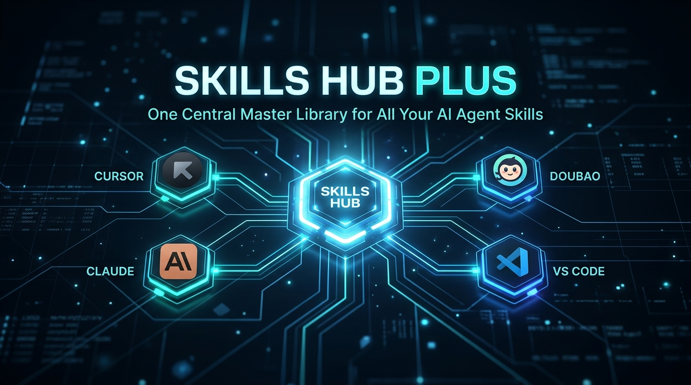
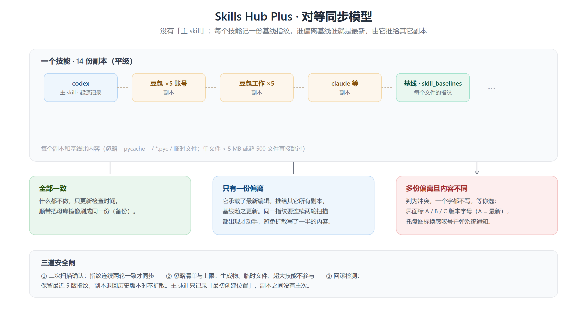
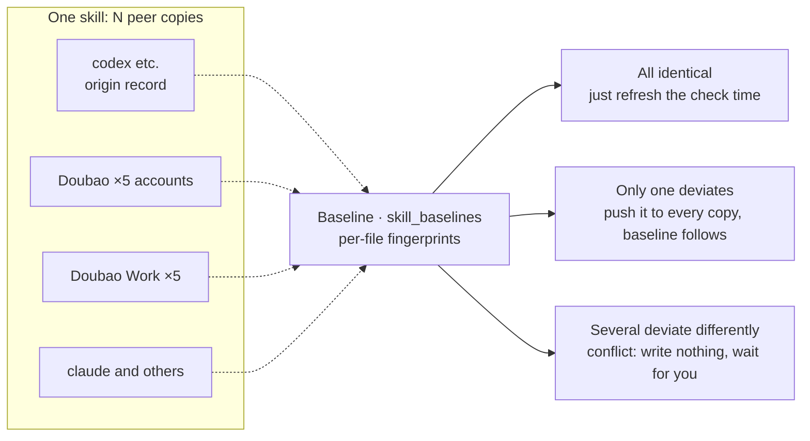
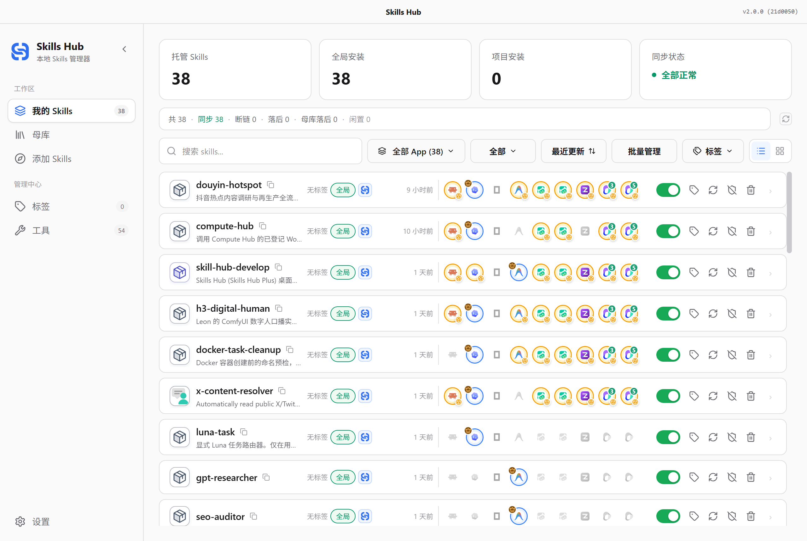
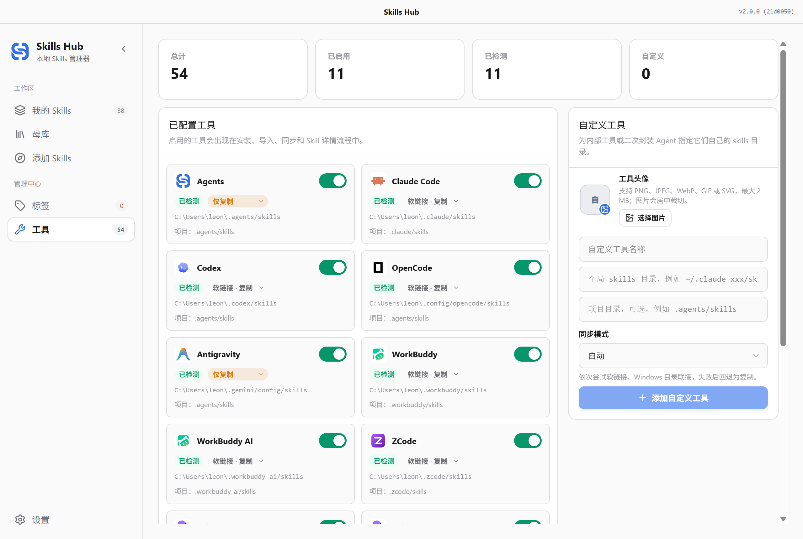
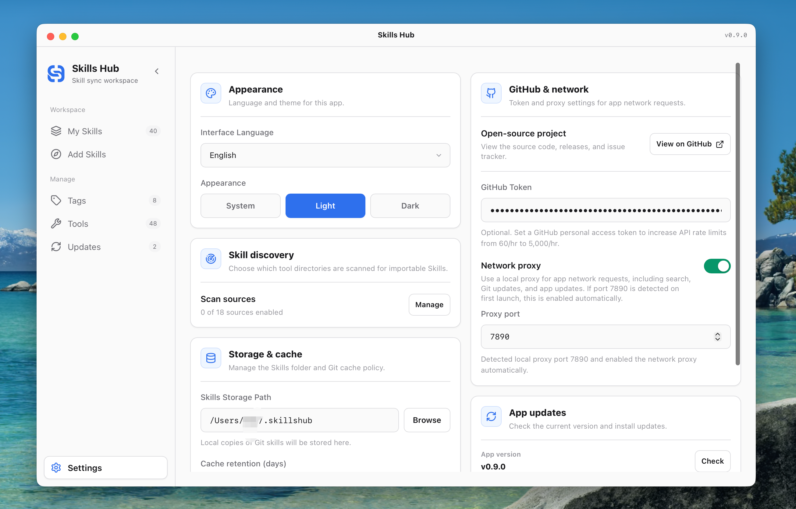
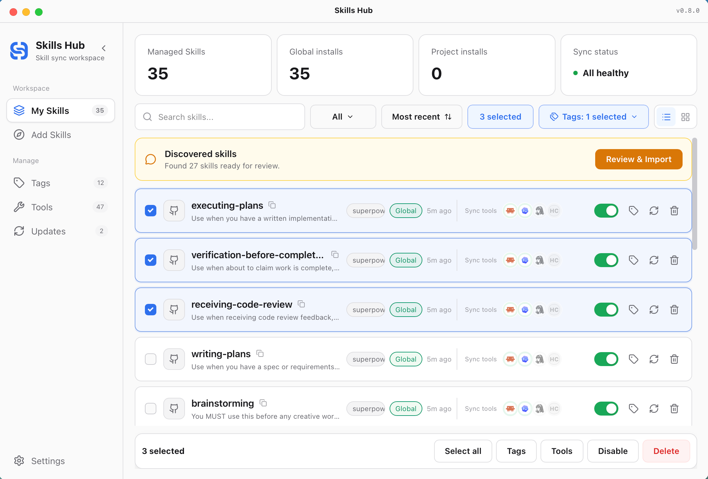
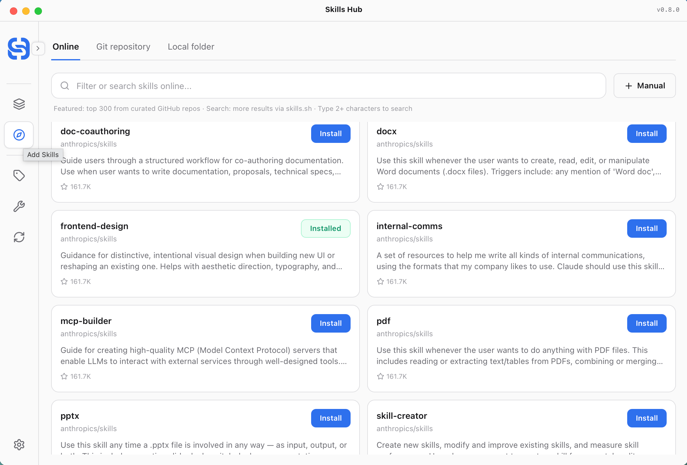
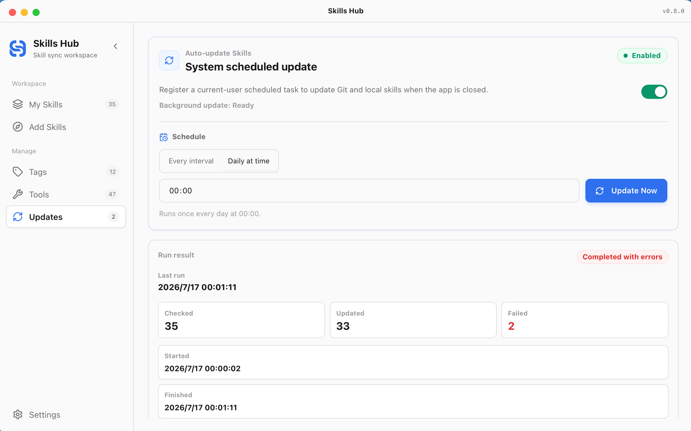

<p align="center">
  
</p>

# Skills Hub Plus

**v1.0.0** · 2026-11-05 · see [CHANGELOG](CHANGELOG.md)

A cross-platform desktop app (Tauri + React) that keeps all your **Agent Skills in one central master library** and syncs them to every AI coding tool on your machine — *"install once, sync everywhere"*.

> **📍 Based on an open-source project** — This project derives from **[qufei1993/skills-hub](https://github.com/qufei1993/skills-hub)** (MIT, baseline `v0.9.1`, via [mcncarl/skills-hub](https://github.com/mcncarl/skills-hub)) and evolves independently as **Skills Hub Plus**. Full credit to the upstream author — see [Acknowledgments](#acknowledgments--license). Upstream is actively developed (v1.0.1 as of 2026-10); differences are documented in [What's different](#whats-different-from-upstream) and [Worth adopting](#upstream-features-worth-adopting).
>
> 中文说明: [`docs/README.zh.md`](docs/README.zh.md)

## Architecture & Sync Model

<p align="center">
  
</p>



Since 2.0 there is **no "master skill"**: every skill keeps one baseline fingerprint
(`skill_baselines`), whoever deviates from that baseline is the newest and gets
pushed to the other copies. The central library `skills/` is just one of those
copies and doubles as the backup; the master skill is only a record of *where the
skill was first created* — copies have no rank among themselves.

Sync has exactly three outcomes:

| Outcome | What happens |
| --- | --- |
| All identical | Nothing is written, only the check time moves; the central mirror is refreshed to the same content (backup) |
| Only one deviates | It carries the latest edit → pushed to every copy, baseline follows |
| Several deviate with different content | Treated as a conflict, nothing is written, you pick (the UI marks A / B / C version letters, the tray shows a warning) |

Three safety gates: ① a fingerprint must show up in two consecutive scans before
it is synced; ② generated files, temp files, files > 5 MB and skills over 500
files are skipped; ③ the last 5 fingerprints are kept, so a copy rolled back to
an older version is not spread.

> **Since 2.0.1 sync has exactly one mechanism: a full directory copy.**
> Symlinks (symlink / junction / auto) are gone — a link collapses N peer copies
> into one file, which breaks "whoever edited it is newest", the version letters
> and the baseline comparison. Legacy link modes in the database are read as copy.

## Screenshots

| My Skills (Master Library) | Tools Management (Doubao, Cursor...) | Settings & Preferences |
|:---:|:---:|:---:|
|  |  |  |

| Bulk Actions | Explore Online Skills | Scheduled Updates |
|:---:|:---:|:---:|
|  |  |  |

## What's different from upstream

Improvements this fork ships on top of the upstream `v0.9.1` baseline:

| # | Improvement | Notes |
|---|---|---|
| 1 | **Peer sync with a per-skill baseline** | Every skill keeps one baseline fingerprint; whichever copy deviates from it is the newest and gets pushed to the other copies. All copies are peers — no master decides. Upstream sync is one-way only. |
| 2 | **Honest tool states** | 🟢 synced (physical copy) / ⚪ not installed — ghost tools removed, honest UI at a glance. |
| 3 | **Portable master library** | The master library lives in `skills/` *next to the app* (not `~/.agents/skills`), making the whole app a ~60 MB self-contained folder you can copy to another PC. See [Migration](#portable-layout--migrating-to-another-pc). |
| 4 | **1-click backup & restore** | Full backup of manifest + SQLite database + skills snapshot; automatic incremental backup before destructive operations; restore to any snapshot. |
| 5 | **Master-library safety guards** | Safe unsync never touches master files; Cline gets an isolated `.cline/skills` target instead of hijacking the central library (`UNSAFE_PATH` crash fixed). |
| 6 | **Fast, freeze-free startup** | Startup adoption and description backfill moved to background workers; redundant SHA256 hashing of existing skills eliminated. |
| 7 | **Cloud CI builds** | Manual GitHub Actions workflow compiles a portable Windows x64 exe in the cloud — no local Rust toolchain, no 14 GB build cache. |
| 8 | **Privacy audit gate** | `npm run check:privacy` scans tracked files, commit emails and credential patterns before every release build. |
| 9 | **Architecture 2.0** | Frontend decomposed into 16 domain hooks (`App.tsx` −60%), backend IPC split into 8 modules, 110 unit tests. |
| 10 | **Trash-only deletion** | Deletions always go through the OS Trash / Recycle Bin; skill-owned icon metadata. |
| 11 | **Skill Shielding & Silent Filter** | Unmanage a skill without breaking tool copies (every copy is a standalone physical folder, so nothing is dereferenced or rewritten); permanently ignore during background scans & onboarding; manage & unignore in Settings. |
| 12 | **Deep Doubao support (both clients)** | Calibrated deep user skill workspaces for Doubao Work (`%LOCALAPPDATA%\DoubaoWork\...\.doubaowork\...`) and the Doubao desktop client (`%LOCALAPPDATA%\Doubao\...\.doubao\...`), plus Qoder CN (`~/.qoder-cn/skills`); redesigned new-tool detection to prevent unwanted bulk skill pushes. |
| 13 | **Software-level shield with per-skill exceptions** | Block an entire tool from discovery, sync and reconciliation, then whitelist individual Skills inside it (entries shaped `tool/skill`) so those keep syncing. Files on disk are never touched, so unblocking restores the exact previous state; shared skill folders only stop being scanned once every tool that owns them is blocked. |
| 14 | **The owner is only an origin record** | `source_ref` keeps the software a skill was first created in, which is what the crown badge shows. It no longer decides who wins — the baseline does — and the central copy is just one peer that doubles as the backup. |
| 15 | **Copy-only sync (2.0.1)** | Symlinks are gone for good: `auto`, `link only` and per-tool modes were removed, leaving a single full-directory copy everywhere. A link would collapse N peer copies into one file and break "whoever edited it is newest", the version letters and the baseline comparison. |

## Upstream features worth adopting

Upstream has moved to v1.0.1 since our baseline; these are the gaps we track, ordered by value to this fork:

| Feature | Upstream since | Why it matters here |
|---|---|---|
| **Multi-device library sync** (GitHub/GitLab/Gitee repo, 3-way merge) | v0.10.0 | Solves "carry skills across PCs" natively — today we do it by copying the folder. Top candidate. |
| **In-app recycle bin** (30-day recovery, restore files + settings) | v0.10.0 | We only delete to the OS trash; an in-app bin with restore is more discoverable. |
| **Collections: browse & install published skill bundles** | v1.0.0 | One-click install of curated skill sets from the skills.sh catalog. |
| **Batch-update selected skills** (per-skill progress, retry) | v1.0.0 | We bulk-sync but can't re-pull many git/local sources in one pass. |
| **Status & tool filters** in the library | v1.0.1 | Filter by enabled/disabled and by synced tool. |
| **Windows junction `\\?\` canonical-path fix** | v1.0.1 | Upstream bugfix; no longer relevant to us since symlinks are gone. |
| AI skill management + standalone CLI | v0.11.0 | Interesting but heavy; low priority. |
| Linux `.deb` / `.AppImage` installers | v0.11.0 | Out of scope — this fork is Windows-first. |

## Roadmap

From our [competitor research](docs/research-competitors-2026-10.md) (skills-manager, SkillDeck, vercel skills and others):

- **P0** ✅ — health badges + idle-skill detection; `skills.lock` export/import *(shipped 2026-10)*
- **P1** — multi-device library sync (upstream v0.10); explore page on the skills.sh ecosystem
- **P2** — operation history with undo; batch updates & filters (upstream v1.0)
- **P3** — in-app recycle bin; usage insights (full version)

## Features

- **One home, physical copies** — every skill lives in the `skills/` folder next to the app, and each tool folder holds its own physical copy: same content, zero interference.
- **Multi-tool sync** — Claude Code, Codex, Cursor, OpenCode, WorkBuddy, ZCode and 50+ adapters. **Since 2.0.1 sync is a full directory copy and nothing else** (symlinks are gone).
- **Edit anywhere, pushed to the other copies** — every skill keeps one baseline fingerprint; whoever deviates from it is the newest and gets pushed to the other copies. If several copies changed differently it is a conflict, nothing is written and you pick.
- **Shield a skill, or a whole tool** — ignore a single Skill during scanning, or freeze an entire software (scan + sync + reconcile) while whitelisting named exceptions inside it. Nothing is deleted either way.
- **Version letters & conflict review**, **backup & restore**, **scheduled auto-updates**, **cloud builds** — see the sections above.

## Reading the skill list

Each row reads left to right: name & description → tag / scope badges → **origin
column** → last update → the tool copies → toggles and actions.

### Origin column: master on the left, owner on the right

| Icon | Meaning | Clicking it |
| --- | --- | --- |
| Blue S badge | The **central mirror** (the copy in `skills/`) | Opens the central folder |
| Tool icon with a crown | The **master skill**: the software this skill was first created in | Opens the skill detail |

The crown marks ownership — it only says where the skill was born, **not** that
its content is the newest.

### Version letters A / B / C

The same skill can hold different content in different tools. The app groups the
copies **by content**, then orders the groups by the newest modification time
inside each group, and labels them A, B, C:

- **A (red) = the newest version**: the group edited most recently
- **B / C (grey) = older content versions**
- Copies with identical content get the **same letter** — letters group by content, not by tool
- **The central mirror takes part too**: a B on the master badge means the mirror is stuck on an older version
- A skill with only one version everywhere gets **no letter**

Letters only say which version is newer; they are not a conflict marker. Real
divergence is reported separately as a conflict in the health bar.

### "Master library behind · click to fix"

The orange button next to a skill name means the central mirror is behind the
original. Clicking it:

1. moves the old mirror directory into the **Trash** (recoverable, not deleted)
2. overwrites the mirror with the **original directory** — files the original
   does not have are removed, so the mirror ends up identical to it
3. recomputes the mirror's content hash and refreshes the list and health state

It only touches the central mirror, **never the copies inside any tool**. The
check is strict: content is compared first, so identical content never counts as
behind; a mirror that is newer than the original, or that contains files the
original lacks, is flagged as hand-edited and left alone for you to decide.

### Other badges

- **Crown** — the master skill of that skill (ownership)
- **Small number** — how many of that tool's account folders already have it (green = all, amber = partial)
- **Red exclamation / broken link** — that copy is unhealthy (broken, hand-edited, behind); click it to refresh or inspect

---

## Portable layout & migrating to another PC

The whole app travels in **~60 MB**:

```
skill-hub/            (repo folder, any path works)
├── dist-app/
│   └── skills-hub.exe   ← the app (frontend embedded, self-contained)
├── skills/              ← master library, all skills live here
├── package.json / .git  ← path anchors for auto-locating skills/
├── backup/              ← optional: tags & settings snapshots
├── dev/                 ← optional: build/launch helper scripts
└── release/             ← optional: local archive of downloaded builds
```

On a new machine: copy the folder, double-click `dist-app\skills-hub.exe` — the central library is auto-adopted on first launch, then re-sync your tools with one click. `node_modules/` and `src-tauri/target/` are never needed to *run* the app.

## Build

- **Cloud (recommended)**: GitHub → **Actions → Build Windows (manual)** → *Run workflow* → download `release-assets-x64` (portable exe + NSIS installer). Free on public repos; ~3 min once cached. Use it consciously — avoid unnecessary runs.
- **Local**: `npm install`, then `npm run tauri:build` (or `dev/build_release.ps1`). Requires Node 20+, Rust/MSVC and ~14 GB of build cache.

## Documentation

- 中文说明:[`docs/README.zh.md`](docs/README.zh.md)
- Changelog: [`CHANGELOG.md`](CHANGELOG.md) / [`docs/CHANGELOG.zh.md`](docs/CHANGELOG.zh.md)
- UI guidelines: [`docs/UI-DESIGN-GUIDELINES.md`](docs/UI-DESIGN-GUIDELINES.md)

## Acknowledgments & License

- **[qufei1993/skills-hub](https://github.com/qufei1993/skills-hub)** — the original project this fork builds upon. All core sync architecture, tool adapters and UI foundations come from upstream. 🙏
- [mcncarl/skills-hub](https://github.com/mcncarl/skills-hub) — the intermediate fork this code line passed through.

MIT — see [LICENSE](LICENSE). Upstream attribution retained.
