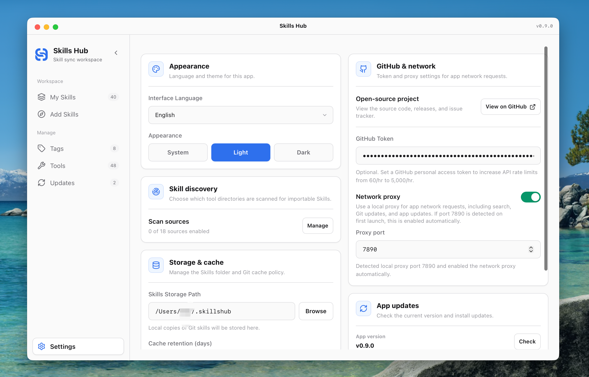

# Skills Hub Plus

A cross-platform desktop app (Tauri + React) that keeps all your **Agent Skills in one central master library** and syncs them to every AI coding tool on your machine — *"install once, sync everywhere"*.

> Fork lineage: MIT-licensed fork of [qufei1993/skills-hub](https://github.com/qufei1993/skills-hub) (via mcncarl/skills-hub), continued independently as **Skills Hub Plus**.
>
> 中文说明:[`docs/README.zh.md`](docs/README.zh.md)

## Screenshots

| My Skills | Tools Management |
|:---:|:---:|
|  |  |
| **Explore Online Skills** | **Settings** |
|  |  |

## Features

- **Central master library** — every skill lives once in the `skills/` folder next to the app, instead of scattered copies across tool folders.
- **Multi-tool sync** — installs skills into each tool's directory via NTFS junction / symlink first, falling back to physical copy when a tool can't follow links (e.g. Cursor). Supported targets include Claude Code, Codex, Cursor, OpenCode, WorkBuddy, ZCode and more.
- **Edit anywhere, synced everywhere** — under junction/symlink mode, editing a skill inside any AI tool edits the master directly; all other tools reflect the change instantly with zero manual sync.
- **Three-state tool model** — 🎨 natively recognized (no copies needed), 🟢 dedicated install (green ring), ⚪ unsynced (one click to sync).
- **Version compare & promote to master** — compares mtime and file trees between each tool and the master; push tool-side improvements back with one click, filtered by `.skillignore`.
- **Backup & disaster recovery** — 1-click full backup (manifest + SQLite database + skills snapshot), automatic incremental backup before destructive operations, 1-click restore to any snapshot.
- **Scheduled auto-update** — git-source skills update on schedule via a registered background task.
- **Cloud builds** — a manual GitHub Actions workflow compiles the Windows x64 portable exe in the cloud; no local Rust toolchain required (see *Build* below).

## Portable layout & migrating to another PC

The whole app travels in **~60 MB**:

```
skill-hub/            (repo folder, any path works)
├── dist-app/
│   └── skills-hub.exe   ← the app (frontend embedded, self-contained)
├── skills/              ← master library, all skills live here
├── package.json / .git  ← path anchors for auto-locating skills/
└── backup/              ← optional: tags & settings snapshots
```

On a new machine: copy the folder, double-click `dist-app\skills-hub.exe` — the central library is auto-adopted on first launch, then re-sync your tools with one click (junctions are per-machine and rebuilt locally). `node_modules/` and `src-tauri/target/` are never needed to *run* the app.

## Build

- **Cloud (recommended)**: GitHub → **Actions → Build Windows (manual)** → *Run workflow* → download `release-assets-x64` from the run page. Contains a portable `*-portable.exe` (drop-in replacement for `dist-app\skills-hub.exe`) and an NSIS installer. Standard runners are free for public repos; a cached run takes ~3 minutes.
- **Local**: `npm install`, then `npm run tauri:build` (or `build_release.ps1`). Requires Node 20+, Rust/MSVC, and ~14 GB free for the build cache — which is exactly why the cloud path exists.

## Documentation

- 中文说明:[`docs/README.zh.md`](docs/README.zh.md)
- Changelog: [`CHANGELOG.md`](CHANGELOG.md) / [`docs/CHANGELOG.zh.md`](docs/CHANGELOG.zh.md)
- UI guidelines: [`docs/UI-DESIGN-GUIDELINES.md`](docs/UI-DESIGN-GUIDELINES.md)

## License

MIT — see [LICENSE](LICENSE). Upstream attribution retained.
