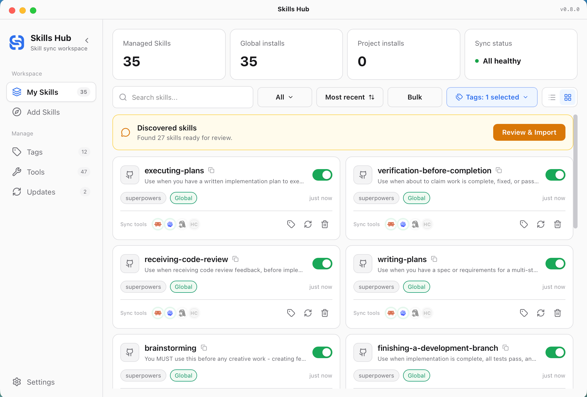
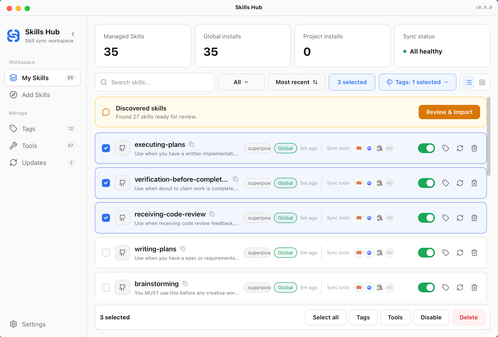
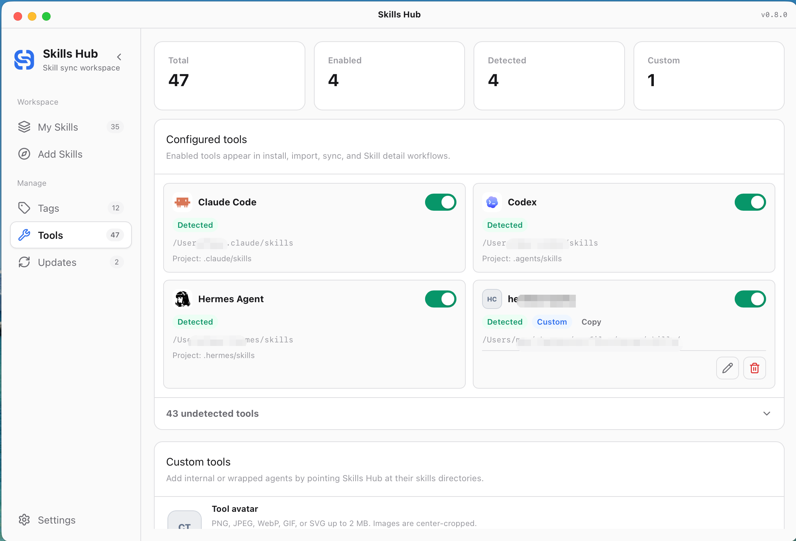
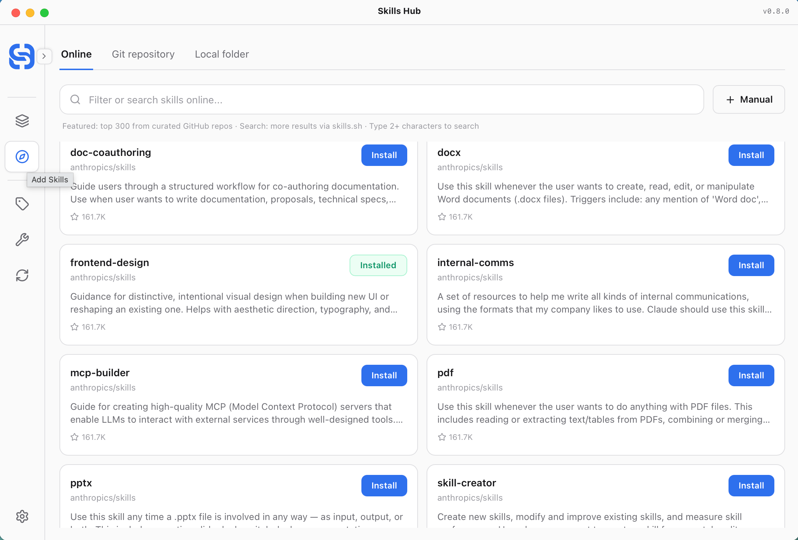
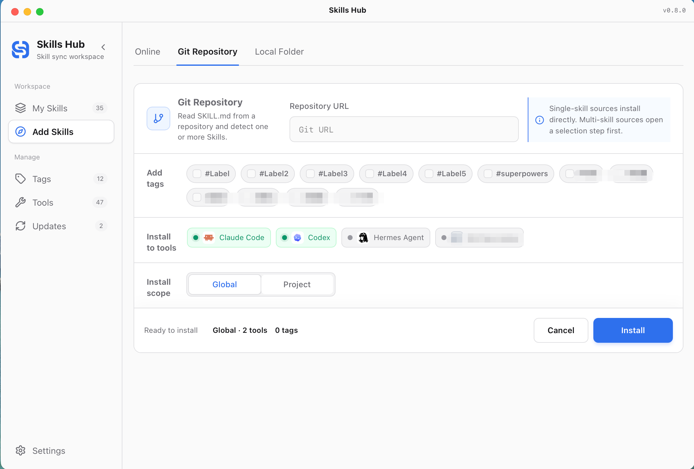
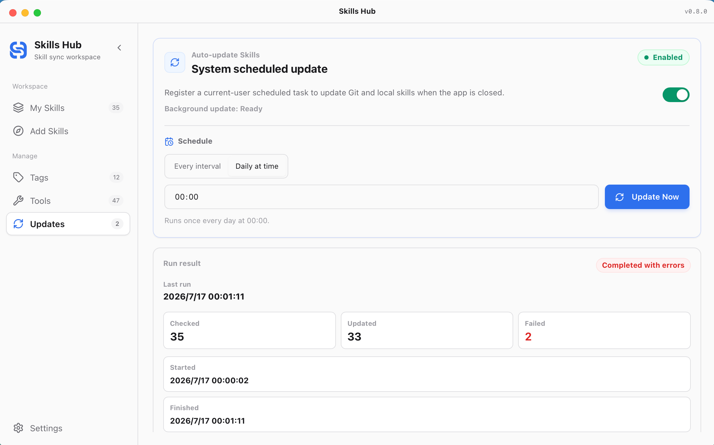

# Skills Hub Plus

A cross-platform desktop app (Tauri + React) that keeps all your **Agent Skills in one central master library** and syncs them to every AI coding tool on your machine — *"install once, sync everywhere"*.

> **📍 Based on an open-source project** — This project derives from **[qufei1993/skills-hub](https://github.com/qufei1993/skills-hub)** (MIT, baseline `v0.9.1`, via [mcncarl/skills-hub](https://github.com/mcncarl/skills-hub)) and evolves independently as **Skills Hub Plus**. Full credit to the upstream author — see [Acknowledgments](#acknowledgments--license). Upstream is actively developed (v1.0.1 as of 2026-10); differences are documented in [What's different](#whats-different-from-upstream) and [Worth adopting](#upstream-features-worth-adopting).
>
> 中文说明:[`docs/README.zh.md`](docs/README.zh.md)

## Screenshots

| My Skills | Bulk Actions | Tools Management |
|:---:|:---:|:---:|
|  |  |  |

| Explore Online Skills | Add from Git | Scheduled Updates |
|:---:|:---:|:---:|
|  |  |  |

## What's different from upstream

Improvements this fork ships on top of the upstream `v0.9.1` baseline:

| # | Improvement | Notes |
|---|---|---|
| 1 | **Reverse "promote to master"** | Compare mtime + file trees between each tool and the master library; push improvements made *inside a tool* back to the central master in one click, with `.skillignore` filtering. Upstream sync is one-way only. |
| 2 | **Three-state tool model** | 🎨 natively recognized (zero-copy) / 🟢 dedicated install / ⚪ unsynced — ghost tools removed, honest UI at a glance. |
| 3 | **Portable master library** | The master library lives in `skills/` *next to the app* (not `~/.agents/skills`), making the whole app a ~60 MB self-contained folder you can copy to another PC. See [Migration](#portable-layout--migrating-to-another-pc). |
| 4 | **1-click backup & restore** | Full backup of manifest + SQLite database + skills snapshot; automatic incremental backup before destructive operations; restore to any snapshot. |
| 5 | **Master-library safety guards** | Safe unsync never touches master files; Cline gets an isolated `.cline/skills` target instead of hijacking the central library (`UNSAFE_PATH` crash fixed). |
| 6 | **Fast, freeze-free startup** | Startup adoption and description backfill moved to background workers; redundant SHA256 hashing of existing skills eliminated. |
| 7 | **Cloud CI builds** | Manual GitHub Actions workflow compiles a portable Windows x64 exe in the cloud — no local Rust toolchain, no 14 GB build cache. |
| 8 | **Privacy audit gate** | `npm run check:privacy` scans tracked files, commit emails and credential patterns before every release build. |
| 9 | **Architecture 2.0** | Frontend decomposed into 16 domain hooks (`App.tsx` −60%), backend IPC split into 8 modules, 110 unit tests. |
| 10 | **Trash-only deletion** | Deletions always go through the OS Trash / Recycle Bin; skill-owned icon metadata. |

## Upstream features worth adopting

Upstream has moved to v1.0.1 since our baseline; these are the gaps we track, ordered by value to this fork:

| Feature | Upstream since | Why it matters here |
|---|---|---|
| **Multi-device library sync** (GitHub/GitLab/Gitee repo, 3-way merge) | v0.10.0 | Solves "carry skills across PCs" natively — today we do it by copying the folder. Top candidate. |
| **In-app recycle bin** (30-day recovery, restore files + settings) | v0.10.0 | We only delete to the OS trash; an in-app bin with restore is more discoverable. |
| **Collections: browse & install published skill bundles** | v1.0.0 | One-click install of curated skill sets from the skills.sh catalog. |
| **Batch-update selected skills** (per-skill progress, retry) | v1.0.0 | We bulk-sync but can't re-pull many git/local sources in one pass. |
| **Status & tool filters** in the library | v1.0.1 | Filter by enabled/disabled and by synced tool. |
| **Windows junction `\\?\` canonical-path fix** | v1.0.1 | Small upstream bugfix directly relevant to our junction-first sync. |
| AI skill management + standalone CLI | v0.11.0 | Interesting but heavy; low priority. |
| Linux `.deb` / `.AppImage` installers | v0.11.0 | Out of scope — this fork is Windows-first. |

## Roadmap

From our [competitor research](docs/research-competitors-2026-10.md) (skills-manager, SkillDeck, vercel skills and others):

- **P0** ✅ — health badges + idle-skill detection; `skills.lock` export/import *(shipped 2026-10)*
- **P1** — multi-device library sync (upstream v0.10); explore page on the skills.sh ecosystem
- **P2** — operation history with undo; batch updates & filters (upstream v1.0)
- **P3** — in-app recycle bin; usage insights (full version)

## Features

- **Central master library** — every skill lives once in the `skills/` folder next to the app.
- **Multi-tool sync** — junction/symlink first, physical copy fallback (e.g. Cursor); Claude Code, Codex, Cursor, OpenCode, WorkBuddy, ZCode and 50+ adapters.
- **Edit anywhere, synced everywhere** — under junction mode, editing inside any AI tool edits the master directly.
- **Version compare & promote to master**, **backup & restore**, **scheduled auto-updates**, **cloud builds** — see the sections above.

## Portable layout & migrating to another PC

The whole app travels in **~60 MB**:

```
skill-hub/            (repo folder, any path works)
├── dist-app/
│   └── skills-hub.exe   ← the app (frontend embedded, self-contained)
├── skills/              ← master library, all skills live here
├── package.json / .git  ← path anchors for auto-locating skills/
├── backup/              ← optional: tags & settings snapshots
├── dev/                 ← optional: build/launch helper scripts
└── release/             ← optional: local archive of downloaded builds
```

On a new machine: copy the folder, double-click `dist-app\skills-hub.exe` — the central library is auto-adopted on first launch, then re-sync your tools with one click. `node_modules/` and `src-tauri/target/` are never needed to *run* the app.

## Build

- **Cloud (recommended)**: GitHub → **Actions → Build Windows (manual)** → *Run workflow* → download `release-assets-x64` (portable exe + NSIS installer). Free on public repos; ~3 min once cached. Use it consciously — avoid unnecessary runs.
- **Local**: `npm install`, then `npm run tauri:build` (or `dev/build_release.ps1`). Requires Node 20+, Rust/MSVC and ~14 GB of build cache.

## Documentation

- 中文说明:[`docs/README.zh.md`](docs/README.zh.md)
- Changelog: [`CHANGELOG.md`](CHANGELOG.md) / [`docs/CHANGELOG.zh.md`](docs/CHANGELOG.zh.md)
- UI guidelines: [`docs/UI-DESIGN-GUIDELINES.md`](docs/UI-DESIGN-GUIDELINES.md)

## Acknowledgments & License

- **[qufei1993/skills-hub](https://github.com/qufei1993/skills-hub)** — the original project this fork builds upon. All core sync architecture, tool adapters and UI foundations come from upstream. 🙏
- [mcncarl/skills-hub](https://github.com/mcncarl/skills-hub) — the intermediate fork this code line passed through.

MIT — see [LICENSE](LICENSE). Upstream attribution retained.
