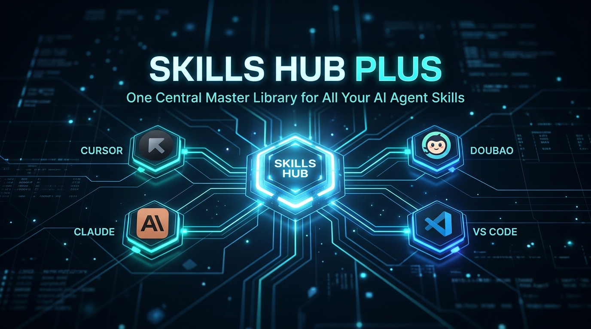
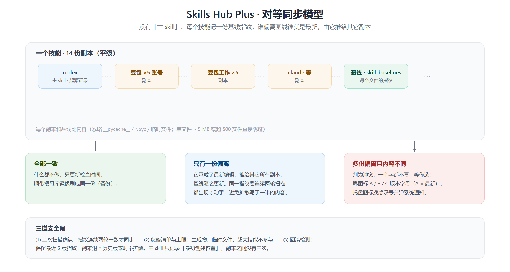
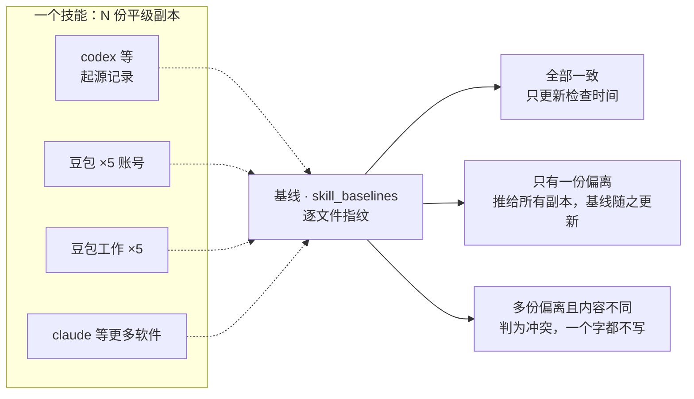
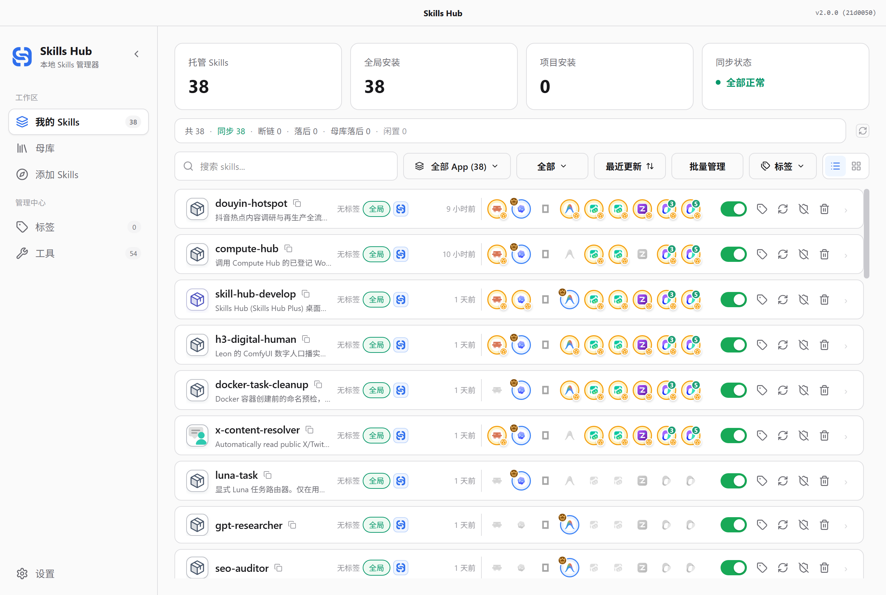
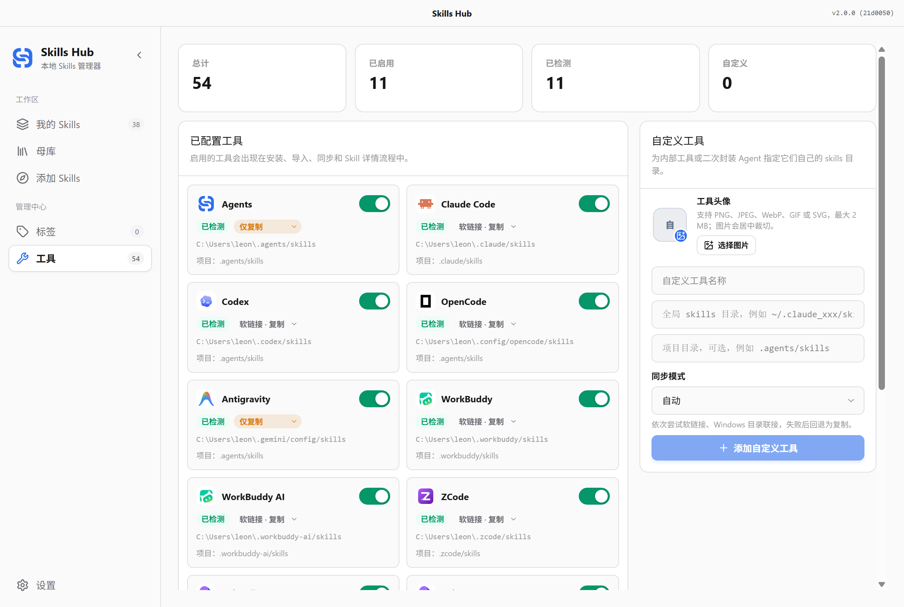
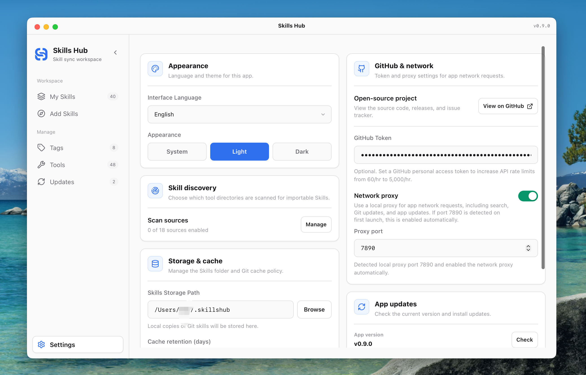
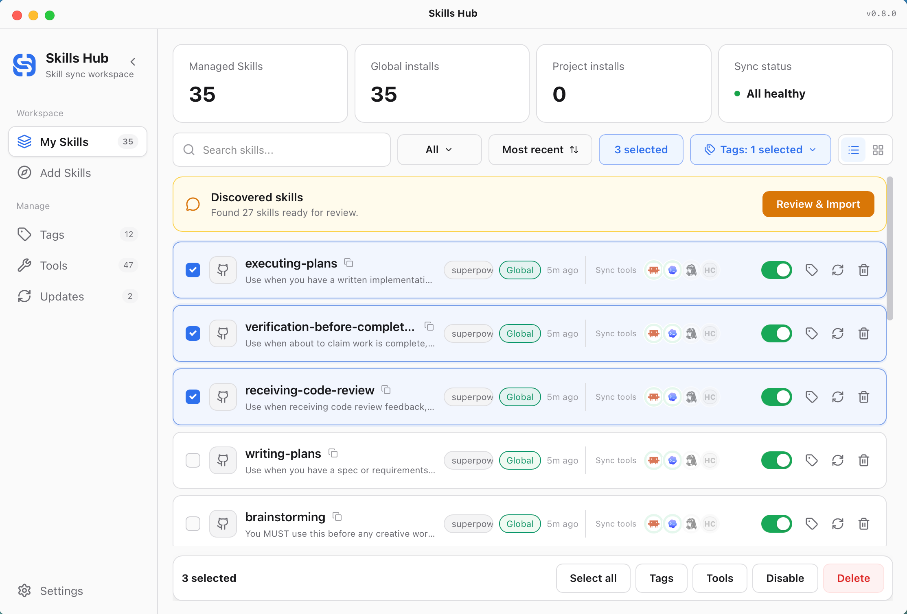
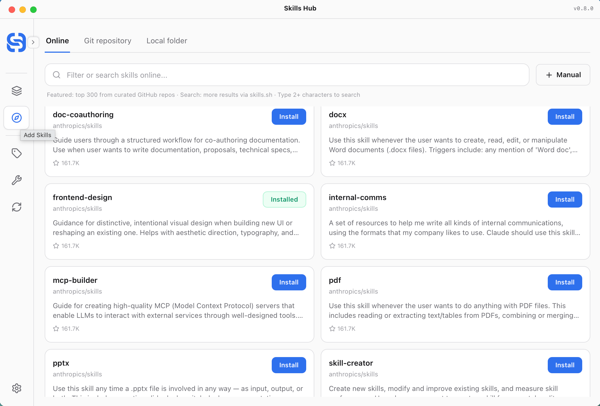
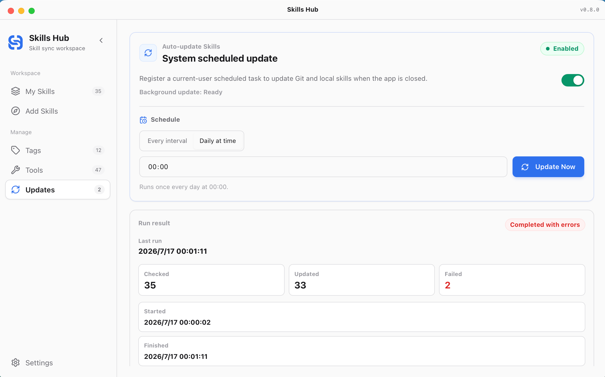

<p align="center">
  
</p>

# Skills Hub Plus

**v1.0.0** · 2026-11-05 · 见 [CHANGELOG](../CHANGELOG.md)

跨平台桌面应用(Tauri + React):把所有 **Agent Skill 集中在一个母版库**里管理,并同步到本机每一个 AI 编程工具——*"装一次,处处同步"*。

> **📍 本项目基于开源项目衍生** — 衍生自 **[qufei1993/skills-hub](https://github.com/qufei1993/skills-hub)**(MIT 协议,基线 `v0.9.1`,经 [mcncarl/skills-hub](https://github.com/mcncarl/skills-hub) 中转),现以 **Skills Hub Plus** 名义独立演进。核心同步架构、工具适配器与界面基础均来自上游,感谢上游作者的出色工作 👏——完整致谢见[文末](#致谢与许可)。上游仍在活跃开发(2026-10 已到 v1.0.1),差异见[《与上游的差异》](#与上游的差异),上游领先的部分见[《值得借鉴的上游功能》](#值得借鉴的上游功能)。
>
> English readme:[`../README.md`](../README.md)

## 架构与同步模型

<p align="center">
  
</p>



2.0 起**不再有「主 skill」**：每个技能记一份基线指纹（`skill_baselines`），
谁偏离基线谁就是最新，由它推给其它副本。母库 `skills/` 是其中一份副本，
同时兼作备份；主 skill 只保留「最初创建位置」这条记录，副本之间没有主次。

同步结果只有三种：

| 结果 | 处理 |
| --- | --- |
| 全部一致 | 什么都不做，只更新检查时间；顺带把母库镜像刷成同一份（备份） |
| 只有一份偏离 | 它承载了最新编辑 → 推给所有副本，基线随之更新 |
| 多份偏离且内容不同 | 判为冲突，一个字都不写，等你选（界面标 A / B / C 版本字母，托盘感叹号提醒） |

三道安全网：① 同一指纹连续两轮扫描都出现才同步；② 忽略 `__pycache__` / `*.pyc` /
临时文件，单文件 > 5 MB 或整技能超 500 文件直接跳过；③ 保留最近 5 版指纹，
副本退回历史版本时不扩散。

> **2.0.1 起同步只有一种方式：整目录复制。**
> 软链接（symlink / junction / auto）已彻底移除——链接会让 N 份副本退化成同一份文件，
> 「谁改谁最新」、版本字母、基线比对都失去意义。历史记录里的链接模式一律按复制解释。

## 截图

| 我的技能 (中心母库) | 工具管理 (豆包工作、Cursor 等) | 设置与偏好 |
|:---:|:---:|:---:|
|  |  |  |

| 批量操作 | 探索在线技能 | 定时更新 |
|:---:|:---:|:---:|
|  |  |  |

## 与上游的差异

本分支在上游 `v0.9.1` 基础上做出的改进:

| # | 改进 | 说明 |
|---|---|---|
| 1 | **对等同步 + 逐技能基线** | 每个技能记一份基线指纹,谁偏离基线谁就是最新,由它推给其它副本。所有副本平级,没有谁说了算。上游只能单向(母版→工具)推送 |
| 2 | **工具状态如实呈现** | 🟢 已同步(实体副本)/ ⚪ 未安装;清除了幽灵工具,状态一目了然 |
| 3 | **便携式母版库** | 母版库放在程序旁的 `skills/` 目录(而非 `~/.agents/skills`),整个应用就是约 60 MB 的自包含文件夹,拷到别的电脑直接能用(见[迁移指南](#便携布局与迁移到其他电脑)) |
| 4 | **一键备份与恢复** | 全量备份(清单 + SQLite 数据库 + skill 快照);破坏性操作前自动增量备份;可恢复到任意历史快照 |
| 5 | **母版库安全守卫** | 安全 unsync 绝不误删母版文件;Cline 使用隔离的 `.cline/skills` 目录,不再劫持中央母版(修复 `UNSAFE_PATH` 崩溃) |
| 6 | **启动提速防卡顿** | 收养与描述回填移到后台线程;跳过对已有 skill 的冗余 SHA256 哈希 |
| 7 | **云端 CI 编译** | GitHub Actions 手动触发即可在云端编出 Windows x64 便携版 exe——本地零工具链、零 14 GB 编译缓存 |
| 8 | **隐私审计闸门** | `npm run check:privacy` 在每次发布构建前扫描跟踪文件、提交邮箱与凭据特征 |
| 9 | **架构 2.0** | 前端拆成 16 个领域 hook(`App.tsx` 减少 60%),后端 IPC 拆成 8 个模块,110 个单元测试 |
| 10 | **仅回收站删除** | 删除一律走系统回收站;skill 拥有自己的图标元数据 |
| 11 | **屏蔽技能与永久防打扰** | 删除技能时支持解除托管并转换为独立实体物理目录,母库移入回收站;自动记录屏蔽白名单并在后续扫描/向导中永久静默;设置页可随时查看并取消屏蔽 |
| 12 | **豆包双客户端深度适配** | 精准校正豆包工作(`%LOCALAPPDATA%\DoubaoWork\...\.doubaowork\...`)与豆包桌面版(`%LOCALAPPDATA%\Doubao\...\.doubao\...`)的用户技能目录,并支持 Qoder CN(`~/.qoder-cn/skills`);重构新工具检测逻辑,杜绝全量强塞母库技能 |
| 13 | **软件级屏蔽 + 技能级例外** | 可整块屏蔽一个软件(不扫描、不同步、不参与自动整理),再用 `工具/技能` 形式的白名单放行其中个别技能继续同步;全程不动磁盘文件,解除屏蔽即恢复原状;共享技能目录只在拥有它的所有工具都被屏蔽时才停止扫描 |
| 14 | **主 skill 只作起源记录** | `source_ref` 保留这份技能最初被创建在哪个软件里(界面上的皇冠徽章),但它不再决定谁说了算——由基线说了算;母库只是其中一份平级副本,兼作备份 |
| 15 | **只复制(2.0.1)** | 软链接彻底移除:`auto`、`仅软链接` 与按工具设置一并删掉,全局只剩整目录复制。链接会让 N 份副本退化成同一份文件,"谁改谁最新"、版本字母、基线比对都会失去意义 |

## 值得借鉴的上游功能

上游自我们的基线后已发布到 v1.0.1,以下是我们关注的差距,按对本分支的价值排序:

| 功能 | 上游版本起 | 对我们的意义 |
|---|---|---|
| **多设备母版库同步**(GitHub/GitLab/Gitee 远程仓库 + 三方合并) | v0.10.0 | 从根上解决"把 skill 带到其他电脑"——目前我们靠拷文件夹。**首选借鉴项** |
| **应用内回收站**(30 天可恢复,连配置一起还原) | v0.10.0 | 我们目前只删进系统回收站;应用内回收站更可控、可发现 |
| **合集 Collections**(浏览并一键安装 skills.sh 上的技能合集) | v1.0.0 | 一次装整套策划好的 skill 集 |
| **批量更新所选技能**(逐条进度、可重试) | v1.0.0 | 我们能批量同步,但还不能一次性按各自 git/local 源重拉更新 |
| **按状态/工具过滤**技能库 | v1.0.1 | 按启用状态、已同步工具筛选 |
| **Windows junction `\\?\` 规范路径修复** | v1.0.1 | 上游小修复;软链接已移除,与我们不再相关 |
| AI 技能管理 + 独立 CLI | v0.11.0 | 用 AI 对话管理技能;工程量大,低优先级 |
| Linux `.deb` / `.AppImage` 安装包 | v0.11.0 | 超出范围——本分支以 Windows 为主 |

## 路线图

出自[竞品调研与借鉴分析](research-competitors-2026-10.md)(skills-manager、SkillDeck、vercel skills 等):

- **P0** ✅ — 健康度徽章 + 闲置技能检测;`skills.lock` 清单导入导出 *(2026-10 已交付)*
- **P1** — 多设备母版库同步(上游 v0.10);发现页接入 skills.sh 生态
- **P2** — 操作历史与一键撤销;批量更新与状态/工具过滤(上游 v1.0)
- **P3** — 应用内回收站;用量洞察(完整版)

## 功能总览

- **集中存放、实体副本** — 所有 skill 放在程序旁的 `skills/` 文件夹里,各软件目录里各有一份实体副本,内容一致、互不干扰
- **多工具同步** — Claude Code、Codex、Cursor、OpenCode、WorkBuddy、ZCode 等 50+ 工具适配器。**2.0.1 起同步只有整目录复制一种方式**(软链接已移除)
- **任意端编辑,自动推给其它副本** — 每个技能记一份基线指纹,谁偏离基线谁就是最新,由它推给其它副本;多份都改过且内容不同则判为冲突,一个字都不写,等你选
- **屏蔽技能,或者屏蔽整个软件** — 单个技能可静默不扫描;也可冻结整个软件(扫描 + 同步 + 自动整理),再用白名单放行其中指定技能。两种操作都不删除任何文件
- 版本字母与冲突对比、备份与恢复、定时自动更新、云端编译——见上文专述

## 列表界面怎么读

技能列表每一行从左到右依次是：名称与描述 → 标签 / 范围徽章 → **来源列** → 更新时间 →
各软件副本图标 → 开关与操作按钮。

### 来源列：左边母库，右边主 skill

| 图标 | 含义 | 点它会 |
| --- | --- | --- |
| 蓝色 S 徽章 | **母库镜像**(`skills/` 里那一份) | 打开母库目录 |
| 带皇冠的软件图标 | **主 skill**:这份技能最初被创建在哪个软件里 | 打开技能详情 |

皇冠表示「归属」——它只说明这份技能诞生于哪里,**不代表它内容最新**。

### 版本字母 A / B / C

同一个技能在不同软件里可能不是同一份内容。应用先按**内容**给它们分组,
再按组内最新修改时间排序,依次标 A、B、C:

- **A(红色)= 最新的一版**:最近被编辑过的那一组
- **B / C(灰色)= 较旧的内容版本**
- 内容完全相同的副本会拿到**同一个字母**——字母按内容分组,不按软件
- **母库也参与分组**:母库显示 B,说明母库停在了旧的那一版
- 全库只有一种内容时**不标字母**

字母只说版本新旧,不等于同步冲突——真出现分歧时,健康栏会单独报「冲突」。

### 「母库落后 · 点击修复」

技能名旁的橙色按钮表示:母库镜像落后于原件。点一下会:

1. 把旧的母库目录移进**回收站**(可恢复,不是删除)
2. 用**原件目录**整目录覆盖母库——原件里没有的文件会被删掉,母库从此等于原件
3. 重算母库内容哈希,刷新列表与健康状态

它只动母库镜像,**不会碰任何软件目录里的副本**。判定也很严谨:先比内容哈希,
内容相同不算落后;母库比原件还新、或母库里多出原件没有的文件,会判为「手改」,
不自动处理,等你人工判断。

### 其它徽章

- **皇冠** —— 这份技能的主 skill(归属)
- **小数字** —— 该软件有多个账号目录时,标出已装此技能的账号数(绿=铺满,琥珀=部分)
- **红色感叹号 / 断链提示** —— 该副本异常(断链、手改、落后),点它可刷新或查看详情

---

## 便携布局与迁移到其他电脑

整个应用拷走只需 **约 60 MB**:

```
skill-hub/            (仓库文件夹,放哪个盘都行)
├── dist-app/
│   └── skills-hub.exe   ← 程序本体(界面已内嵌,自包含)
├── skills/              ← 母版库,所有 skill 在这里
├── package.json / .git  ← 自动定位 skills/ 用的锚点
├── backup/              ← 可选:标签与配置的备份快照
├── dev/                 ← 可选:构建/启动辅助脚本
└── release/             ← 可选:下载构建的本地归档
```

新电脑上:整个文件夹拷过去,双击 `dist-app\skills-hub.exe`——首次启动自动"收养"母版库里的全部 skill,然后逐个工具点一次同步重建链接。**运行程序完全不需要** `node_modules/` 和 `src-tauri/target/`。

## 构建

- **云端编译(推荐)**:GitHub → **Actions → Build Windows (manual)** → *Run workflow* → 下载 `release-assets-x64`(便携版 exe + NSIS 安装包)。公开仓库免费,缓存命中后约 3 分钟。**按需触发,避免不必要的运行**。
- **本地编译**:`npm install` 后执行 `npm run tauri:build`(或 `dev/build_release.ps1`)。需要 Node 20+、Rust/MSVC,编译缓存约占 14 GB 硬盘。

## 文档

- English readme:[`../README.md`](../README.md)
- 更新日志:[`../CHANGELOG.md`](../CHANGELOG.md) / [`CHANGELOG.zh.md`](CHANGELOG.zh.md)
- UI 设计规范:[`UI-DESIGN-GUIDELINES.zh.md`](UI-DESIGN-GUIDELINES.zh.md)

## 致谢与许可

- **[qufei1993/skills-hub](https://github.com/qufei1993/skills-hub)** — 本项目赖以衍生的原项目:核心同步架构、50+ 工具适配器、界面基础均来自上游。🙏
- [mcncarl/skills-hub](https://github.com/mcncarl/skills-hub) — 本代码线经过的中间分支。

MIT — 见 [LICENSE](../LICENSE),保留上游出处说明。
